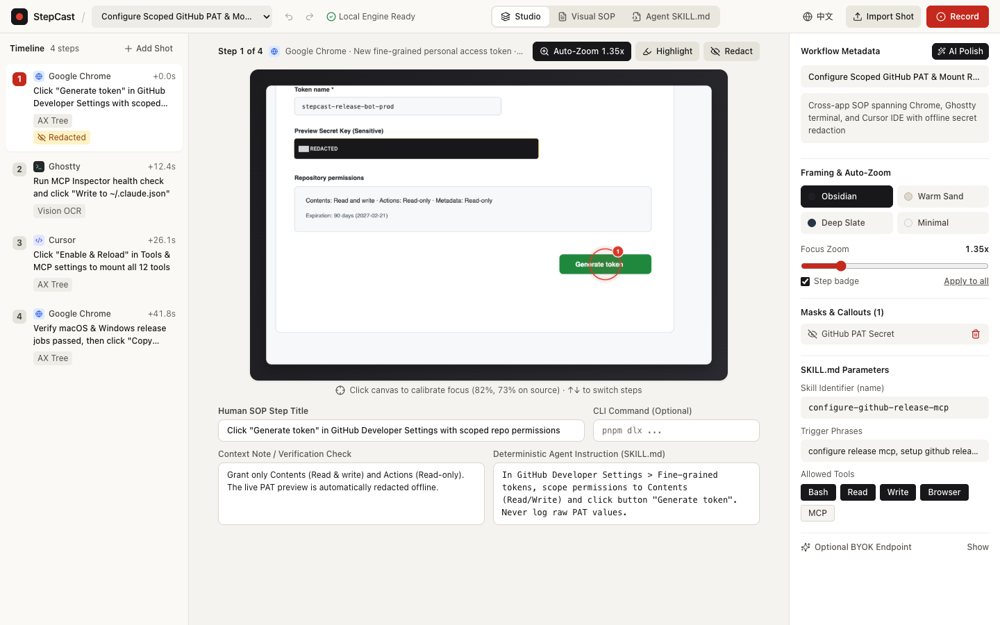
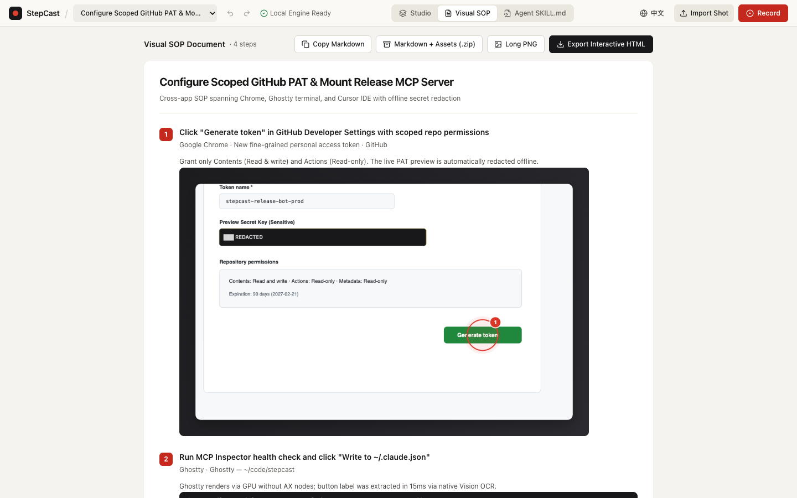
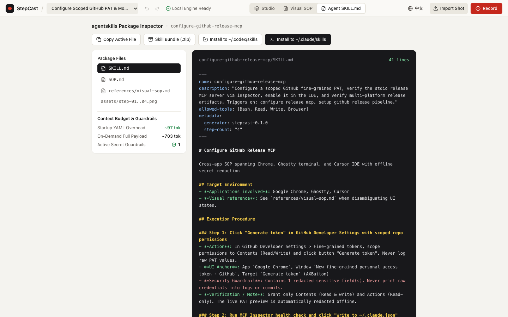

<div align="center">

# StepCast

**Demonstrate once. Ship both a publication-grade visual SOP and a deterministic AI Agent `SKILL.md`.**

[](./LICENSE)
[](#installation--development)
[](https://v2.tauri.app)

[English](./README.md) · [简体中文](./README.zh-CN.md) · [Contributing](./CONTRIBUTING.md) · [Security Model](./SECURITY.md)

</div>

---

**StepCast** is a 100% local-first, zero-telemetry open-source desktop studio (macOS & Windows) that records your workflow across **any browser, terminal, IDE, or native desktop app**—turning a 15-second human walkthrough into two high-leverage artifacts simultaneously:

1. **For Humans**: A clean, Screen-Studio-styled visual Standard Operating Procedure (standalone interactive `.html` walkthrough player, GitHub-ready `.md` + `assets/` `.zip`, or high-DPI vertical `.png`)—replacing \$35/mo cloud-locked SaaS tools like Scribe Pro.
2. **For AI Agents**: A specification-compliant [`agentskills`](https://github.com/agentskills/agentskills) **`SKILL.md` package** with YAML frontmatter, UI control anchors, CLI commands, and security guardrails—ready for one-click installation into `~/.claude/skills`, `~/.codex/skills`, or `~/.cursor/skills`.



---

## Why StepCast?

| Capability | Cloud SaaS Recorders (Scribe / Tango) | Browser-Only Extensions | **StepCast (Open Source)** |
| :--- | :--- | :--- | :--- |
| **Desktop, Terminal & Native Apps** | Paid Pro tier (\$29–\$35/mo) | Browser tab only | **Free & Native (macOS + Windows)** |
| **Data Privacy & Internal Dashboards** | Uploaded to vendor cloud | Local or cloud | **100% Local SQLite & Offline Redaction** |
| **GPU Terminals / Electron UI Labels** | Often blank coordinates | N/A outside browser | **Hybrid OS Accessibility + 15ms Native OCR** |
| **AI Agent `SKILL.md` Compilation** | None | None | **Native 1-Click Install to Claude / Codex / Cursor** |
| **GPU / Model Bloat** | Low | Low | **Zero bundled LLM weights (<15 MB app)** |

---

## Key Highlights

### 1. Hybrid Zero-Weight Control Recognition (`AX` + Native Offline OCR)
Many modern desktop apps (Ghostty, Warp, WeChat, Feishu, custom Electron views) do not expose full accessibility nodes. StepCast inspects the OS Accessibility Tree (`AXUIElement` on macOS, `UIAutomation` on Windows) first in `<1ms`; whenever a control returns an empty label, it automatically crops around the click coordinate and invokes the OS's built-in offline OCR (`Vision.framework` on macOS) in ~15ms—requiring **zero model downloads and zero GPU memory bloat**.

### 2. Offline Automatic Secret Redaction & Privacy-by-Design
- **Auto-Detected Secret Masks**: Captured frames are scanned locally for common credential formats (`sk-...`, `ghp_...`, `github_pat_...`, `AKIA...`, JWTs), pre-populating destructive black redaction masks before you export.
- **Zero Keylogging**: Plain alphanumeric keystrokes (passwords, messages) are never recorded—only explicit `⌘`/`⌃` command shortcuts and pointer clicks.

### 3. Screen-Studio-Inspired Auto-Zoom Framing & Floating HUD
- **Floating Recording Pill**: Clicking **Record** minimizes the Studio into a sleek always-on-top HUD pill so your workspace stays unobstructed.
- **Smart Focus Framing**: Automatically centers a `1.0x – 2.8x` viewport crop around each click coordinate so readers never squint at tiny 4K screenshots.

### 4. Dual-Track Exports
- **Interactive HTML Guide**: Single self-contained `.html` file featuring both a scrollable publication view and an interactive **Step-by-Step Replay Player**.
- **Portable `.zip` Bundle**: Exports `<slug>/SKILL.md`, `<slug>/SOP.md` (using clean relative `assets/step-01.png` links instead of editor-freezing base64 blobs), and rendered PNG frames.

| Publication Visual SOP | Agent `SKILL.md` Compiler |
| :---: | :---: |
|  |  |

---

## Quick Start

### Prerequisites
- **Node.js** 20+ & **pnpm** 9+
- **Rust** 1.77.2+ (`rustup`)
- **macOS**: Xcode Command Line Tools (`xcode-select --install`)
- **Windows**: Visual Studio C++ Build Tools & WebView2

### Run from Source

```bash
git clone https://github.com/botshen/stepcast.git
cd stepcast
pnpm install

# Launch full native Tauri v2 desktop app (macOS / Windows)
pnpm tauri dev

# Or preview the Studio & compilers in browser mode with the 4-step demo flow
pnpm dev
```

### Run Automated Tests & Build Desktop Installer

```bash
pnpm test
cargo test --manifest-path src-tauri/Cargo.toml
pnpm tauri build
```

---

## License

Released under the [MIT License](./LICENSE).
