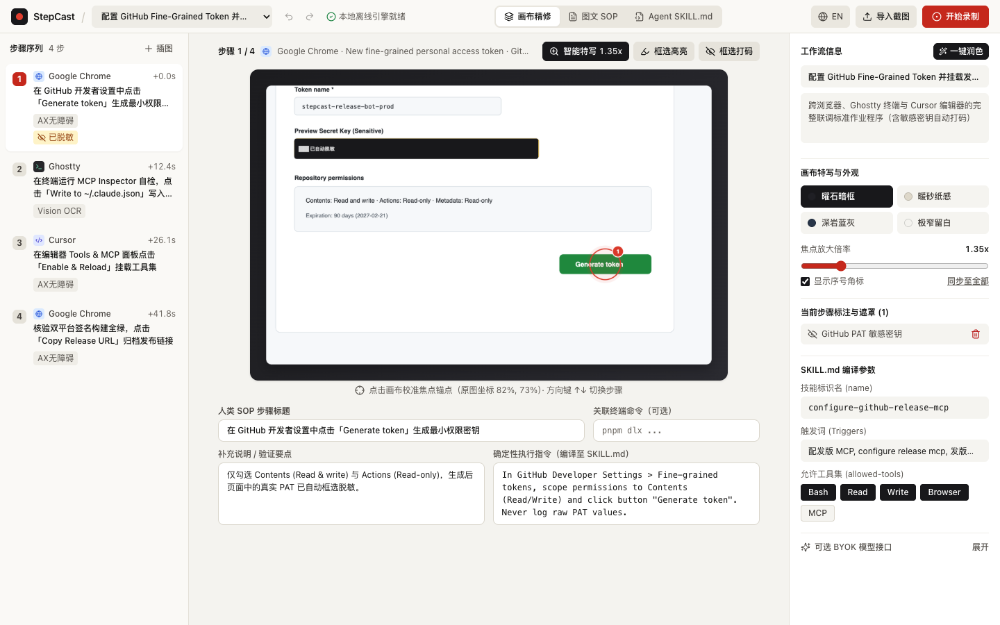

<div align="center">

# StepCast（步映）

**操作演示一遍，同时产出「Screen Studio 级精美图文 SOP」与「AI Agent 标准 `SKILL.md` 技能包」。**

[](./LICENSE)
[](#快速开始)
[](https://v2.tauri.app)

[English](./README.md) · [简体中文](./README.zh-CN.md) · [贡献指南](./CONTRIBUTING.md) · [安全与隐私架构](./SECURITY.md)

</div>

---

**StepCast（步映）** 是一款 100% 本地优先、零遥测的跨平台开源桌面软件（支持 macOS 与 Windows）。只需在浏览器、终端、IDE 或任意桌面客户端正常操作一遍流程（15 秒），即可**一鱼两吃**同时编译生成：

1. **面向人类同事 / 客户 / 读者**：带自动局部聚焦放大、空心红圈锚点与敏感信息自动打码的**标准作业图文手册**（支持导出内置分步回放器的单文件离线 `.html`、干净相对路径 `.md + assets/` 压缩包、以及适合群聊与社媒传播的高清一图流 `.png`），免费平替 \$35/月的闭源 Scribe Pro。
2. **面向本地 AI 编程 Agent**：严格遵循 [`agentskills`](https://github.com/agentskills/agentskills) 规范的 **`SKILL.md` 技能目录包**（含 YAML 渐进式披露头、控件定位锚点、关联终端命令与安全脱敏守则），一键直装进本机 `~/.claude/skills`、`~/.codex/skills` 或 `~/.cursor/skills`。



---

## 核心技术亮点

- **零模型体积的「无障碍树 + 系统原生 OCR」双引擎识别**：
  优先毫秒级读取系统无障碍树（macOS `AXUIElement` / Windows `UIAutomation`）；当遇到微信、飞书、Ghostty 终端或自绘 Electron 窗口拿不到控件节点时，自动裁切鼠标周围小区域调用操作系统内置离线 OCR（macOS `Vision.framework` 识别中英文仅需约 15ms），**0 模型下载、不挑电脑配置、普通核显轻薄本全程零卡顿**。
- **离线自动密钥脱敏与隐私防线**：
  截屏瞬间在本地离线扫描 `sk-...`、`ghp_...`、`github_pat_...`、`AKIA...`、JWT 等敏感凭证并自动预置黑色遮罩；键盘监听严格仅记录显式 `⌘`/`⌃` 快捷键组合，**绝不记录任何明文密码或聊天打字输入**。
- **悬浮录制胶囊窗 + 局部聚焦画布**：
  点击「开始录制」自动收起主工作台并浮起置顶计步小胶囊，不遮挡操作视线；支持 `1.0x ~ 2.8x` 点击焦点自动特写、框选高亮与打码、25 步撤销/重做（`⌘Z` / `⌘⇧Z`）及中英双语实时切换。

---

## 快速开始

```bash
git clone https://github.com/botshen/stepcast.git
cd stepcast
pnpm install

# 启动完整原生桌面客户端（含全系统捕获与悬浮胶囊窗）
pnpm tauri dev

# 运行前后端单元测试
pnpm test
cargo test --manifest-path src-tauri/Cargo.toml

# 打包原生桌面安装包 (.app / .dmg / .exe)
pnpm tauri build
```

---

## 开源协议

基于 [MIT License](./LICENSE) 开源发布。
